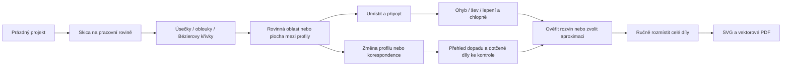

# P2 v1.2 — návrh autorského pracovního prostředí

Návrhový autor: samostatný agent v týmu obnovy, 6. listopadu 2026. Podklad: [úplné upřesnění vlastníka a modely A/B/C/D](OWNER_CLARIFICATION.txt). Stav: návrh pro společný v1.2 kontrakt a nezávislou revizi. **Není to popis již implementovaných schopností, technické schválení ani PO akceptace.** Nová doména a persistence zůstávají draftem, dokud je neovlivní výsledky požadovaných geometrických spiků.

## Výsledek pro modeláře

Autor začne prázdným projektem a vytvoří vlastní konstrukci: obrys nebo profil → plocha/plášť → umístění a připojení → ohyb/spoj → autorské chlopně → rozvin → ruční stránky → SVG/PDF. Otevřená budova bez dna, samostatná stěna, vložené ostění a základna jsou normální modely. Požadavek uzavřeného vodotěsného objemu do tohoto průchodu nepatří.

Hotové prvky jsou volitelná pomůcka nad stejnými kreslicími a konstrukčními operacemi. Model vytvořený presetem musí jít prohlédnout, rozměrově upravit a spojovat stejně jako ručně vytvořené prvky. Testovací dům nebude jediná dostupná konstrukce ani povinná úvodní obrazovka. [Gap audit zdrojů](CODE_DISPOSITION.md) uvádí, proč dnešní house-oriented UI a schéma tuto cestu zatím neumějí.

## Pracovní prostor

Hlavní režimy jsou **Konstrukce / Skica / Spoje a díly / Stránky**. Sdílejí výběr a identitu prvku; přepnutí režimu nepřesune díly a nezruší rozpracovaný kontext. Skica v modelových souřadnicích a tisková stránka v paper mm jsou odlišná plátna, vždy pojmenovaná i jednotkově. Kreslení profilu není kreslení dekorace do již hotového SVG.

| Umístění | Co autor vidí a ovládá |
|---|---|
| Horní lišta | Projekt, undo/redo, režim, měřítko modelu, zobrazení pracovní roviny. U nástroje vždy Potvrdit/Zrušit a název rozpracované operace. |
| Levý strom | Autorské skici/profily, plochy/pláště, připojovací prvky a základny; navázané papírové díly a stránky. Libovolné názvy autora, samostatné stálé číslo dílu a srozumitelné stavy. Ne povinný strom osmi house surfaces. |
| Hlavní plocha v konstrukci | Současný 3D pohled a aktivní lokální skica; pracovní rovina, osy, přední strana, profily, korespondence a náhled povrchu. |
| Hlavní plocha ve spojích/stránkách | Propojené 3D a papírové díly/stránky, odkládací plocha, vybraná hrana i protikus, lepicí oblast a kotva dílu. |
| Pravé vlastnosti | Číselné rozměry a constraints vybraného prvku, hloubka a umístění profilu, korespondence, typ připojení, parametry chlopní a stav rozvinu. V layoutu X/Y/úhel kotvy a nezávislé zámky. |
| Spodní přehled problémů | Konkrétní prvek/spoj, místo, dopad a další krok. Výběr problému zvýrazní skutečný region; připravenost se nevyjadřuje jediným procentem. |

Prázdný stav ukáže „Nakreslit obrys/profil“, „Vytvořit pracovní rovinu“ a volitelně „Vložit ověřený prvek“. Strom nemá žádné předstírané díly, výchozí podlaha ani hotovou budovu. Export vysvětlí, že zatím neexistuje tiskový díl. Již známý prototypový dům lze otevřít jako fixture/pomůcku, nikoli automaticky vložit místo prázdného projektu.

## Skica, křivky a rozměry

Autor zvolí rovinu XY/XZ/YZ, vlastní umístěnou rovinu nebo rovinnou plochu existujícího prvku. Vždy vidí modelové jednotky a vlastní počátek roviny. Náhled umístění v 3D lze měnit bez přepsání lokálního tvaru profilu. Převody m/cm/mm se provádějí jednou na vstupu; změna zobrazené jednotky nepřepočítává už uloženou konstrukci.

Sada nástrojů úplného P2 v1.2 je uvedena níže. PC-006A/B začíná úsečkami, polygonovými obrysy a jejich základními vazbami; skutečné oblouky a Bézierovy křivky doplňuje PC-007A. Žádná meziverze je nepředstírá předem vzorkovanou sítí.

- **Úsečka / lomená čára:** postupné body, délka a úhel číselně, přichycení na existující bod/osu. Otevřený profil je legitimní skica; aplikace jej nesmí potichu uzavřít.
- **Kruhový oblouk:** střed–poloměr–úhly nebo tři body, volba směru a krátkého/dlouhého oblouku. Kružnice je skutečná křivka, ne předem zvolený počet mesh segments.
- **Kubická Bézierova křivka:** koncové body a ovládací úchopy; rozlišený hladký bod a ostrý vrchol. Gotický hrot zůstává záměrný ostrý bod, pokud jej autor výslovně nevyhladí.
- **Základní vazby:** totožnost konců, vodorovně/svisle, délka, poloměr, úhel, pevný bod a tangence tam, kde má jednoznačný smysl. Nedourčená skica může být validní a editovatelná; přeurčená má ukázat konkrétní konflikt. Vazba se nesmí „splnit“ změnou jiné zamčené hodnoty bez informace.
- **Editace:** vybrat/přesunout bod nebo úchop, číselně upravit parametr, rozdělit křivku v určeném místě, obrátit orientaci profilu a uzavřít otevřený konec explicitním příkazem. Původní identita křivky a navazující reference mají dohledatelný původ.

Přichycení je nápověda geometrické vazby; pouhá blízkost dvou bodů automaticky nevytvoří topologický spoj. Při uzavření obrysu se zvýrazní výsledná oblast a případné otvory. Self-intersection, nulový oblouk nebo neplatný poloměr se odmítnou před aplikací. Přesná číselná hodnota se nesmí přepsat zaokrouhlenou hodnotou pouze proto, že pole získalo a ztratilo fokus. Drag bodu/úchopu je jediná undo operace; Esc obnoví stav před tažením.

## Od profilu k ploše a prostorovému plášti

Výběr vede k různým srozumitelným příkazům, nikoli k jednomu mesh fallbacku:

| Vstup | Nástroj a očekávaný náhled |
|---|---|
| Jeden uzavřený rovinný obrys, případně další vnitřní smyčky | **Plocha z obrysu.** Náhled materiálu s odečtenými otvory. Volný vnější okraj je přípustný; nevznikají automatické boční stěny a dno. |
| Dvě otevřené křivky v téže rovině | **Rovinný pás.** Autor zvolí dvojice konců a výslovně potvrdí spojovací úsečky, jsou-li potřeba. Výsledek je jedna rovinná materiálová oblast, nikoli dva náhodně uzavřené profily. |
| Dvě uzavřené vnořené smyčky v téže rovině | **Oblast s otvorem / prstenec.** Vnější a vnitřní boundary, žádný prostorový loft mezi totožnými rovinami. |
| Dva profily v různých rovinách | **Plocha mezi profily.** Zůstávají editovatelné oba profily, jejich prostorové umístění a explicitní korespondence. Otevřený strip nebo plášť bez vík je validní konstrukce. |
| Profil tažený po přímém směru / ověřený oblouk pláště | **Stěna/plášť z profilu.** Plynulé stočení je oddělené od záměrného ostrého přehybu a od segmentované náhrady. |

Prostorový nástroj „Plocha mezi profily“ má tři kroky v jednom vratném příkazu:

1. **Profily a umístění.** A/B, pracovní roviny, vzdálenost/posun/rotace, viditelné lokální osy. Změna hloubky nepozmění obrys bez příkazu autora.
2. **Korespondence.** Směr profilu, začátek, pojmenované páry bodů — například levá pata, hrot a pravá pata gotického ostění. Náhled spojnic mezi odpovídajícími místy. U ruled varianty jsou tyto spojnice tvořící přímky; obecnější hladký loft není automaticky tentýž geometrický typ. Rozdílný počet segmentů se řeší mapováním intervalů, ne pouhým párováním sampled vertex indexů. Překřížené mapování a nesouhlasné orientace jsou konkrétní problém k opravě.
3. **Konstrukce a výroba.** Náhled povrchu, jednotlivých oblastí/hran a výsledku klasifikace rozvinu. Autor může vytvořit validní prostorovou plochu i tehdy, když pro ni zatím neexistuje přesný souvislý rozvin. Tiskový výsledek pak zůstává k dořešení, nikoli falešně aktuální.

Uložení uchová původní křivky, constraints, korespondenci a rozhodnutí autora. Případná tessellace je zobrazení a ověřovací pomůcka, ne nová autorita geometrie. Přidání kontrolního bodu nebo změna hustoty náhledu nesmí přepárovat spoje, změnit čísla dílů či ztratit placement.

## Skutečné díry a ostění

Otvor v panelu má vlastní uzavřený vnitřní obrys, musí být opravdu prázdný při 3D/2D picking, triangulaci, kontrole materiálu i exportu. Nejde o světlý potisk nebo vykreslený cutter. UI rozliší „Potisk okna“, „Výřez“ a „Ostění“; aktivní nástroj slibuje jen skutečně implementovanou schopnost.

„Vytvořit ostění“ použije otvor/přední profil a druhý zadní profil. Autor nastaví hloubku a tvar zadního obrysu nezávisle, případně šikmé umístění. Vidí, kde navazuje přední hrana na otvor a kde se připojí zadní obrys. Ostění je sada ploch/plášťů se záměrným dělením; aplikace nevytváří nevyžádané víko otvoru ani plný objem zdi. Zadní vnitřní obklad může být samostatný autorský díl.

Dotyk otvoru s vnější hranicí vyžaduje výslovnou změnu na výřez do okraje nebo opravu profilu. Otevřená smyčka, samopřekryv, přerušená korespondence a nulová hloubka v prostorovém režimu mají konkrétní zprávu. Nulová hloubka může být platný rovinný pás, ale nedává automaticky stejné prostorové ostění; UI nabídne tento jiný význam před potvrzením.

## Přesahy, podhledy, základna a vnitřní připojení

Přesah střechy lze určit pro jednotlivé okapy a štíty nebo vlastní úpravou obrysu. Při změně přesahu zůstane čára styku stěny uvnitř střešní plochy. Náhled ukáže **vnější řezný obrys**, **čáru připojení** a **materiálovou lepicí oblast** odlišným stylem i názvem. Přesah se nesmí odstranit, jen aby vyhověl dvěma shodným boundary edges.

Příkaz „Připojit“ nabízí význam podle zvolených prvků:

- **Hrana ↔ hrana:** kompatibilní intervaly, orientace, vůle a papírový cut/fold podle skutečné konstrukce.
- **Hrana ↔ čára uvnitř plochy:** autor vybere zdrojovou hranu a cílovou připojovací čáru na střeše/základně. Cílová čára zůstává uvnitř materiálu a není řezem; umístění a strana lepení jsou vidět v 3D i rozvinu.
- **Lepicí oblast:** uzavřená oblast na cílové ploše, zdrojový díl/chlopeň a zamýšlená orientace. Kontroluje se skutečná použitelná plocha po odečtení otvorů a po případném oříznutí, ne jen shodná délka.

Pohled na spoj vždy ukáže oba díly, jejich stránky a popis cíle typu „čára uvnitř levé střechy“ místo tvrzení „protější okraj“. Klik na jednu stranu zvýrazní příslušnou čáru nebo plochu na druhé straně, i když druhý díl leží na jiné stránce. Konstrukční připojení, výrobní přehyb a lepení jsou oddělené volby; vnitřní připojovací čára se nestane fold nebo CUT jen tím, že je u ní lepidlo.

Základna je běžný samostatný prvek z vlastního obrysu, případně s otvory a výškovými úrovněmi. „Promítnout obrys osazení“ vytvoří dohledatelný footprint/čáru nebo oblast na zvolené základně. Sám nevyřízne díru a neuzavře dno budovy. Autor zvolí, zda chce pouze lepicí značky, skutečný otvor nebo přídavné spojovací prvky. Tvarovaný terén je pozdější capability; základní plochá základna a jednotlivé stupně nemusí čekat na obecný terrain mesh editor.

Podhled může vzniknout jako samostatná plocha z obrysu a být připojen stejnými nástroji. Nová první verze má umožnit tento způsob vlastní konstrukce. Oboustranný potisk téhož dílu neslibovat bez samostatně vyřešené registrace, strany papíru a exportu; není náhradou chybějící konstrukce podhledu. Zobrazení/označení strany A/B musí být možné už kvůli správnému směru ohybu na otevřených plochách.

## Autorské chlopně a místo pro lepení

Panel „Spojovací prvky“ pracuje s konkrétním spojem a vybraným intervalem zdrojové hrany. Autor volí souvislou chlopeň nebo dělený vzor; u vzoru počet/rozteč, mezery, počáteční a koncové odsazení, šířku v paper mm, trojúhelníkový či zúžený tvar a orientaci. Jednotlivé chlopně lze upravit/vypnout bez ztráty zbytku vzoru. Nové generování respektuje explicitní overrides, případně vyžádá řešení konfliktu.

U zakřivené hrany je dělení vázané na parametry a fyzickou délku původní křivky, ne na množství triangle edges v náhledu. Na stočeném plášti UI ukáže rozestupy současně ve 3D a v rozvinu. Ostré konce a místa s velkou změnou směru mohou vyžadovat mezeru nebo úlevový výřez; aplikace nabídne náhled, ale neprovede tichý konstrukční řez.

Povinné kontroly jsou odlišné: materiálový překryv chlopně s dílem/chlopní; prostor u základny ohybu pro zvolený tvar; a existence/velikost skutečné cílové lepicí oblasti. Vizualizace ukáže problematický úsek a protikus. Neznámá mechanická dostupnost spoje nebo budoucí fyzická pevnost se nesmějí tvářit jako automaticky prokázané. Fyzickou použitelnost ověří člověk při výtisku a sestavení.

## Rozvin, chyby a řízená alternativa

| Stav v UI | Co znamená | Dostupný další krok |
|---|---|---|
| Přesný rozvin ověřen | Konkrétní podporovaný geometrický typ a numerické/topologické kontroly prošly v definované toleranci | Zkontrolovat švy/chlopně a ručně rozmístit. |
| Přesný rozvin nebyl prokázán | Dostupný backend nedokáže tvrzení doložit; není to samo o sobě důkaz matematické nemožnosti | Zobrazit důvod, vybrat podporované dělení nebo řízenou aproximaci; případně pokračovat pouze v konstrukci. |
| Tuto souvislou plochu nelze přesně rozvinout | Existuje konkrétní matematický/geometrický důvod v daném režimu | Náhled řezu, rozdělení na podporované plochy nebo explicitně aproximovaný výsledek s chybou. |
| Aproximovaný rozvin | Autor zvolil konkrétní metodu a segmentaci, uložená je odchylka i výrobní důsledky | Ukázat odchylku povrchu, hran/párování a nově vzniklé švy/díly; upravit parametr nebo potvrdit tuto variantu. |
| Výpočet selhal | Implementační chyba nebo neplatný vstup, nikoli podporovaný geometrický verdikt | Zachovat původní projekt a autorský stav, ukázat konkrétní chybu; neopravovat ji přepnutím na neoznačený mesh fallback. |

Odchylka aproximace se uvádí konkrétně — například maximální prostorová odchylka v model mm a její dopad v paper mm, délková chyba párovaných hran a zvolené nové dělení. Samostatná procentní „připravenost“ to nenahradí. Není dovoleno bez oznámení měnit měřítko, natahovat díly nebo vynechat chybějící oblast. Potvrzení varování nepromine stale geometrii, rozbité reference nebo neúplné pokrytí modelu.

## Kotvy, revize a zachování ruční práce

Ve 2D dílu je vždy vidět jeho autorská kotva a osa; X/Y v layoutu polohují právě tuto kotvu. Zdrojem může být pojmenovaný bod skici, stabilní místo na křivce, konstrukční datum nebo jiná explicitně podporovaná reference. Sampling a aktuální obálka dílu nejsou identita kotvy.

Změna obrysu nebo přesahu zachová placement a zámky nedotčených dílů. Pro dotčený díl se zobrazí původní obrys a nový náhled s textem, co se změnilo: profil, korespondence, trim, spoj nebo tab pattern. Nejednoznačná reference dostane „Kotvu/spoj je nutné znovu určit“, nikoli automatické přesměrování na nejbližší nový vertex. Kompletní export je do vyřešení blokován.

Při join autor před potvrzením vidí, z kterého dílu se přebírá rámec, a zda se jiné části pohnou. Při split kořenový potomek zachová kotvu, další části mají dohledatelnou lokální mapu a lineage. Není-li přenos jednoznačný, nové díly se označí ke kontrole nebo umístění. Ručně zamčený díl nelze potichu posunout. Změna kotvy má vlastní náhled a jediné undo celého dopadu. Změna potištěné strany není skryté zrcadlení konstrukce.

## Čtyři skutečné přejímací průchody

### A — vlastní otevřená budova, přesah a základna

1. Nový prázdný projekt, model mm a zvolené měřítko. Autor nakreslí půdorys a vytvoří vlastní stěny; nepoužije house preset. Dno zůstává nevytvořené a není hlášeno jako chyba.
2. Z vlastních profilů/obrysů vytvoří střechu. U jednotlivých okapů a štítů nastaví odlišné přesahy nebo je upraví v obrysu. Vnější roof cut hranice pokračuje za vršek stěn.
3. Horní hranu stěny připojí k čáře uvnitř střešní plochy. Náhled rozlišuje cílovou lepicí oblast od řezné hranice. Chlopeň na stěně má jediné vlastnictví a odpovídající vnitřní cíl na střeše.
4. Nakreslí samostatnou základnu, promítne na ni footprint a zvolí lepicí oblast nebo skutečný otvor. Budova se osadí bez přidání nevyžádané spodní stěny. Volitelný podhled nebo výztuhu autor vytvoří běžnými plošnými nástroji.
5. Uloží/otevře, vytvoří rozvin, ručně rozmístí nejméně na dvě stránky a vyexportuje SVG/PDF. Změna přesahu nesmí přesunout nedotčené stěny nebo smazat vazbu na základnu. Export zachová přesah a vnitřní lepicí značky; jejich čáry nejsou CUT.

### B — ostění mezi dvěma odlišnými obloukovými/gotickými profily

1. Autor nakreslí přední obloukový/gotický profil z přímek a skutečných oblouků/křivek, zadní obrys vytvoří samostatně nebo odvozenou kopií, kterou číselně změní. Rozdílný tvar a hloubka musí zůstat editovatelné.
2. V téže rovině si nejprve může zobrazit rovinný pás; po prostorovém umístění druhého profilu se zvolí plocha mezi profily. Autor páruje paty, hrot a další potřebné body, zkontroluje směr a tvořící přímky.
3. Ostění naváže na skutečný otvor ve stěně; otvor zůstane prázdný v modelu, náhledu dílu i exportu. Chybné mapování nebo zkroucený pás dostanou konkrétní náhled opravy.
4. Pro jednu časným spikem doloženou arc rodinu se předvede přesný rozvin. Pro konkrétní odlišný gotický řez se použije ověřený přesný postup, nebo vědomě zvolená segmentace/aproximace s uvedenou chybou. Celý B nesmí skončit pouze „nepodporováno“ a odkladem za presetový dům.
5. Save/open zachová křivky, korespondenci a švy; ruční layout a SVG/PDF zachovají skutečný otvor, oddělené díly a spojovací reference. Editor proof se vztahuje na konkrétní výstup tohoto řezu.

### C — stočený plášť s dělenými trojúhelníkovými chlopněmi

1. Autor vytvoří vlastní oblouk/profil a z něj podporovaný plynule stočený plášť. UI jej neoznačí jako sadu ostrých přehybů jen kvůli zobrazené tessellaci.
2. Určí uzavírací šev a na vybraném intervalu připojovací hrany vloží dělené trojúhelníkové chlopně. Zadá počet/rozteč, mezery, koncové odsazení a paper-mm šířku; jednu chlopeň upraví nebo vypne.
3. Náhled ukáže vztah jednotlivých chlopní k původní křivce, jejich cílové připojení a místo pro ohyb. Autor vyvolá a opraví konkrétní kolizi či nedostatečnou lepicí oblast.
4. Změní hustotu zobrazovací sítě: tvar, počet tabů, vlastní override, spoje a kotva zůstanou stejné. Pak změní skutečný profil: dotčené výsledky se označí ke kontrole.
5. Uloží/otevře, přesně rozvine podporovaný typ, ručně rozmístí a vyexportuje SVG/PDF. Tab pattern musí zůstat částí fyzického dílu/skupiny a být samostatně editovatelný podle SVG rolí.

### D — skutečně nerozvinutelná prostorová plocha

1. Autor vytvoří prostorovou plochu z odlišných profilů s korespondencí, pro kterou časný spike doloží nemožnost přesného souvislého rozvinu v daném režimu.
2. Při požadavku přesného rozvinu UI ukáže konkrétní důvod a nezamění vygenerovaný mesh za hotový přesný díl. Konstrukce a dřívější ruční práce zůstanou zachované.
3. Návrh dalšího postupu nabídne skutečně implementovanou alternativu: nové řezy/dělení nebo řízenou aproximaci. Náhled ukáže nové díly, švy, potřebné chlopně a konkrétní chybu. Autor může návrh zrušit bez změny projektu.
4. Po přijetí alternativy se uloží její parametry, identity/lineage a stav přijetí pro tuto revizi. Save/open a ruční layout/export tuto aproximaci nesmějí přeznačit na „přesnou“. Pokud použitelná alternativa zatím neexistuje, tiskový výstup zůstane jasně blokovaný; není to úspěšně dodaný celý D workflow.

Každý podporovaný řez musí projít těmito kroky přes skutečné UI, nikoli jen ručním vytvořením JSON nebo vložením obecného mesh přes test harness. Následná fyzická sestavitelnost vyžaduje lidský kalibrovaný výtisk a sestavení konkrétní verze.

## První autorská verze a dokončené P2 v1.2

První skutečně použitelná autorská verze je dokončené **PC-006A + PC-006B** a celý model A. Oblouky/Bézier, B/C a postup D následují v PC-007A/B a PC-008 a zůstávají povinnou součástí úplného P2 v1.2. Toto rozlišení odpovídá společnému [kontraktu](P2_IMPLEMENTATION_CONTRACT.md) a [roadmapě](ROADMAP.md); není přijetím rozsahu za vlastníka. První verze musí skutečně vytvářet vlastní konstrukci od prázdného projektu, nikoli jen nabídnout presetový dům s rozšířeným menu.

| Schopnost | První autorská verze PC-006A/B | Navíc v úplném P2 v1.2 |
|---|---|---|
| Prázdný projekt a vlastní skica | Úsečky, lomené otevřené profily a polygonové obrysy, základní číselné vazby a editace | PC-007A: skutečné kruhové oblouky a kubické Bézierovy křivky a jejich editace. Obecný CAD solver, NURBS a všechny vazby nejsou slíbeny. |
| Vlastní materiálové plochy | Rovinné oblasti s topologickými otvory, lomené části a otevřené skořepiny; díry skutečně odečtené v UI i exportu | Profilové prostorové plochy a jejich ořezání v rozsahu doložených typů. Univerzální CSG ani uzavřený objem nejsou podmínkou. |
| Plocha mezi profily a zakřivený plášť | Prostorové umístění vlastních rovinných dílů; úspěšný A bez požadavku na obecný loft | PC-007A/B: dvě editovatelné křivky v prostoru, explicitní korespondence a úspěšný B/C řez podle spikem doložených typů. Neprokázaný loft nemá EXACT. |
| Otevřená budova, přesah, základna | Všechny kroky A bez house presetu; samostatný podhled/výztuha běžnými plošnými nástroji, základna a jednoduché stupně | Rozšíření na obloukové ostění a podporované pláště. Oboustranný tisk bez registrace a pokročilý tvarovaný terén nejsou slíbeny. |
| Připojení uvnitř materiálu | Edge–edge, edge–interior line a adhesive area s přehledným cílem a výstupními vodítky | Tytéž cíle na podporovaných zakřivených plochách s mapováním do materiálu. Přesah se nikdy nenahrazuje falešným ztotožněním vnějších hran. |
| Autorské chlopně | Vlastní rovné/zúžené/trojúhelníkové chlopně, počet/mezery/šířka/owner/off, samostatný pásek a kontrola příjemce v rozsahu A | PC-007B: dělení kolem zakřivené hrany, stabilní intervaly a individuální overrides, prostorová lepicí plocha, relief a kolize. Simulace pevnosti není slíbená. |
| Pravdivá výroba a zachování práce | Validovaný rovinný rozvin a stromové přehyby, kotvy/revize, undo, save/open, ruční švy a stránky, 3D↔2D výběr, SVG/PDF a relevantní editor proof | PC-008: pravdivé odmítnutí EXACT a použitelná označená alternativa D s uvedenou chybou, zachovaná až do IO/layoutu/exportu. PC-009/010 konsolidují celé digitální P2; technický PASS nenahrazuje PO ani fyzickou stavbu. |

Nejistoty algoritmů se musí promítnout do konkrétní podporované podmnožiny, UI zpráv a testů ještě před uzavřením domény. Dělení realizace neodkládá vlastní tvorbu ani vnitřní připojení za presetový dům a neuzamyká schéma podle osmi house panels. Návrh dat už od začátku počítá s celým P2 v1.2, i když první autorský průchod A používá úsečkové obrysy. [Zachovaný prototyp](PRESERVATION.md) a jeho pin `f9507e325c479c8b703e7f52c410de6847958720` zůstávají oddělené od implementace těchto nových schopností.

## Ověření návrhu a následného produktu

Nezávislý reviewer návrhu zkontroluje A/B/C/D proti architektuře, skutečným výsledkům spiků, queue a normativnímu kontraktu; tento dokument napsal autor návrhu a sám sobě nezávislé schválení neuděluje. PO zvlášť přijímá konkrétní produktový rozsah. Dřívější přijetí omezeného kontraktu v1.1, dílčí Qt/geometry testy a editor proof domu se nezmění zpětně na přijetí nebo ověření nových schopností.

Při implementaci se pro každý podporovaný řez předá konkrétní projekt a export, pin zdroje, verze editoru a jasný digitální výsledek; až poté přichází lidský výtisk a fyzická akceptace. Jednotlivý podařený experiment nebo čas jeho běhu není celé funkční předání.
